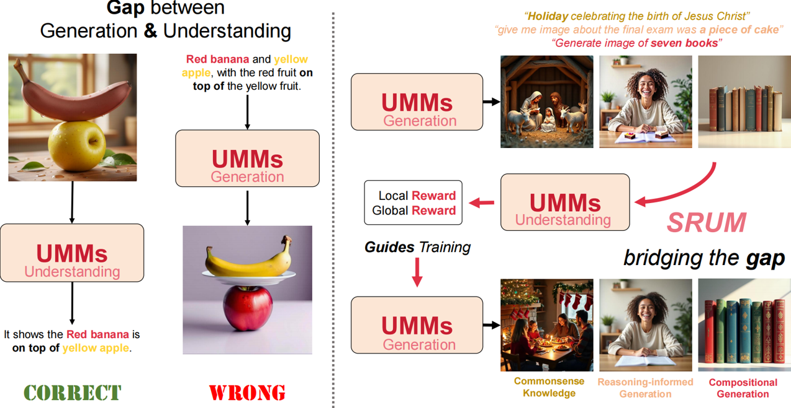
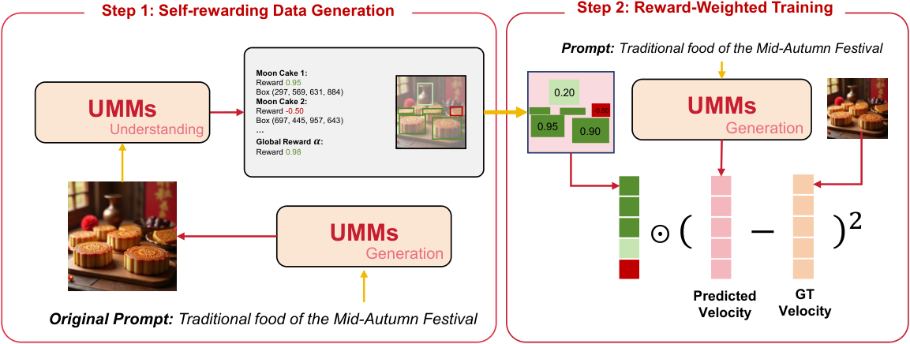

<h1 align="center">SRUM: Fine-Grained Self-Rewarding<br>for Unified Multimodal Models</h1>

<p align="center">
<a href="https://waynejin0918.github.io/home/">Weiyang Jin</a><sup>*1</sup> &nbsp;
<a href="https://purshow.github.io/">Yuwei Niu</a><sup>*2</sup> &nbsp;
Jiaqi Liao<sup>1</sup> &nbsp;
Chengqi Duan<sup>1</sup> &nbsp;
Aoxue Li &nbsp;
Shenghua Gao &nbsp;
<a href="https://xh-liu.github.io/">Xihui Liu</a><sup>1</sup>
</p>

<p align="center">
<sup>*</sup>Equal contribution &nbsp;·&nbsp;
<sup>1</sup>University of Hong Kong &nbsp;·&nbsp;
<sup>2</sup>Peking University
</p>

<p align="center"><b>ECCV 2026</b></p>

<p align="center">
  <a href="https://github.com/HKU-MMLab"></a>
  <a href="https://arxiv.org/abs/2510.12784"></a>
  <a href="https://huggingface.co/Wayne-King/SRUM_BAGEL_7B_MoT"></a>
  <a href="https://github.com/HKU-MMLab/SRUM"></a>
  <a href="https://hku-mmlab.github.io/SRUM/"></a>
  <a href="docs/evaluate.md"></a>
</p>

<p align="center">
  
</p>

<p align="center">
  
</p>
<p align="center">
  <em>SRUM uses a UMM's own understanding module to reward its generation module — no extra human labels.</em>
</p>

<p align="center">
  <b>Project page:</b> <a href="https://hku-mmlab.github.io/SRUM/">https://hku-mmlab.github.io/SRUM/</a>
</p>

<p align="center">
  <a href="#overview">Overview</a> &bull;
  <a href="#method">Method</a> &bull;
  <a href="#results">Results</a> &bull;
  <a href="#quick-start">Quick Start</a> &bull;
  <a href="#evaluation">Evaluation</a> &bull;
  <a href="#related">Related</a> &bull;
  <a href="#citation">Citation</a>
</p>

## Overview

Unified multimodal models (UMMs) share one stack for understanding and generation, yet a model that can **describe** an image often still fails to **draw** what the prompt asks. A UMM may correctly parse “red banana on yellow apple” while generating the swapped binding — the failure is executable, not merely linguistic. SRUM treats that gap as a training signal: freeze the understanding side as an internal evaluator, score generated candidates with a **global–local dual reward**, and update only the generation / flow parameters.

| | Question | How this repository studies it |
| :---: | --- | --- |
| **Q1** | Can understanding supervise generation without human labels? | Offline self-rewarding: understanding scores candidates; generation is updated. |
| **Q2** | What reward granularity is needed? | Global layout weight **α** plus local region map **R**. |
| **Q3** | Does it transfer beyond one metric? | Gains on T2I-CompBench and T2I-ReasonBench (BAGEL + SRUM). |

Paper numbers below are reported cells. This repository ships the BAGEL-compatible stack, self-reward modules, and eval entry points under `Bagel/eval/`. Training details: [docs/method.md](docs/method.md). Bench protocol: [docs/evaluate.md](docs/evaluate.md). Project page: [hku-mmlab.github.io/SRUM](https://hku-mmlab.github.io/SRUM/).

## Key Findings

1. **Understanding ≠ generation.** Correct captions do not guarantee correct pixels; attribute binding and spatial order often break at generation time.
2. **Dual rewards matter.** Global α alone is too coarse; local region map R keeps object-level errors visible to the loss.
3. **Transfer without preference data.** BAGEL + SRUM (CoT) reaches **88.37** CompBench overall and **46.75** ReasonBench average, with **no extra human reward labels**.

## Method

<p align="center">
  
</p>

Offline self-rewarding (paper setting):

1. Sample candidates from the base UMM (~6K).
2. Freeze the understanding module as evaluator (**no evaluator gradients**).
3. Score with global layout weight **α** and local region map **R**.
4. Update generation / flow parameters with

```text
L = L_r + λ_c · L_ref ,   λ_c = 0.5
```

Defaults: **AdamW**, lr **2.5×10<sup>−5</sup>**, warmup **500**, grad clip **1.0**.

| Module | Path |
| --- | --- |
| Scoring prompts | `srum/prompts.py` |
| Dual-reward helpers | `srum/rewards.py` |
| Training skeleton | `srum/train_srum.py` |
| BAGEL stack | `Bagel/` |

## Results

<p align="center">
  
</p>

**Composition (T2I-CompBench overall)**

| Model | Overall |
| --- | ---: |
| Bagel | 82.18 |
| Bagel (CoT) | 84.46 |
| **Bagel + SRUM (CoT)** | **88.37** |

**Reasoning-informed (T2I-ReasonBench)**

| Model | Average |
| --- | ---: |
| Bagel | 43.82 |
| Bagel + SFT | 45.37 |
| **Bagel + SRUM** | **46.75** |

Full category tables: [Hugging Face model card](https://huggingface.co/Wayne-King/SRUM_BAGEL_7B_MoT) · [arXiv](https://arxiv.org/abs/2510.12784).

## Quick Start

### 1. Environment

```bash
git clone https://github.com/HKU-MMLab/SRUM.git
cd SRUM
pip install -r requirements.txt
# Optional flash-attn: see Bagel/README.md
```

### 2. Checkpoints

```bash
python scripts/download_ckpt.py \
  --repo ByteDance-Seed/BAGEL-7B-MoT \
  --out models/BAGEL-7B-MoT

python scripts/download_ckpt.py \
  --repo Wayne-King/SRUM_BAGEL_7B_MoT \
  --out models/SRUM_BAGEL_7B_MoT
```

### 3. Inference

Point the BAGEL inferencer at the SRUM checkpoint:

```bash
cd Bagel
# app.py / inference.ipynb / inferencer.py
# model path -> ../models/SRUM_BAGEL_7B_MoT
```

<details>
<summary><b>Inference hyperparameters</b></summary>

| Param | Role | Typical |
| --- | --- | --- |
| `cfg_text_scale` | Text guidance (`1.0` = off) | `4.0–8.0` |
| `cfg_image_scale` | Image preservation | `1.0–2.0` |
| `cfg_interval` | Denoising fraction with CFG | `[0.4, 1.0]` |
| `timestep_shift` | Early layout vs late detail | — |
| `num_timesteps` | Denoising steps | `50` |
| `cfg_renorm_type` | `global` / `channel` / `text_channel` | `global` (T2I) |

</details>

### 4. Self-reward dry run

```bash
python -m srum.train_srum --dry-run \
  --candidate-manifest data/candidates.example.jsonl \
  --output-dir outputs/srum_dry
```

## Evaluation

Main benches in the paper:

| Benchmark | Focus | Link |
| --- | --- | --- |
| **T2I-CompBench** | Compositional T2I | [GitHub](https://github.com/Karine-Huang/T2I-CompBench) |
| **T2I-ReasonBench** | Reasoning-informed T2I | see paper / HF card |

Related suites available via `Bagel/eval/` (same family as BAGEL releases):

| Benchmark | Focus | Link |
| --- | --- | --- |
| GenEval | Object composition | [GitHub](https://github.com/djghosh13/geneval) |
| DPG-Bench | Dense prompt following | [ELLA / DPG](https://github.com/TencentQQGYLab/ELLA) |
| WISE | World-knowledge T2I | [GitHub](https://github.com/PKU-YuanGroup/WISE) |
| ImgEdit / GEdit / KRIS / RISE | Editing & reasoning edits | `Bagel/scripts/eval/` |

Step-by-step: [docs/evaluate.md](docs/evaluate.md).

## Related

| Project | Links |
| --- | --- |
| **BAGEL** | [Code](https://github.com/ByteDance-Seed/Bagel) · [Model](https://huggingface.co/ByteDance-Seed/BAGEL-7B-MoT) · [Paper](https://arxiv.org/abs/2505.14683) |
| **T2I-CompBench** | [Code](https://github.com/Karine-Huang/T2I-CompBench) |
| **WISE** | [Code](https://github.com/PKU-YuanGroup/WISE) |
| **RecA** | [Code](https://github.com/horizonwind2004/reconstruction-alignment) (related UMM post-training) |
| **MIST** | [Code](https://github.com/HKU-MMLab/MIST) (lab sibling repo style) |

<details>
<summary>Repository layout</summary>

```text
SRUM/
├── Bagel/       # inference, training, eval scripts
├── srum/        # self-rewarding modules
├── scripts/     # checkpoint download
├── docs/        # project page + guides
├── assets/      # README figures
└── citation.bib
```

</details>

## Citation

```bibtex
@inproceedings{jin2026srum,
  title={Srum: Fine-grained self-rewarding for unified multimodal models},
  author={Jin, Weiyang and Niu, Yuwei and Liao, Jiaqi and Duan, Chengqi and Li, Aoxue and Gao, Shenghua and Liu, Xihui},
  booktitle={European Conference on Computer Vision},
  pages={675--691},
  year={2026},
  organization={Springer}
}
```

## License

Apache 2.0 (see `LICENSE`). BAGEL components follow their upstream terms.

## Acknowledgements

A project from **[HKU MMLab](https://github.com/HKU-MMLab)**. Built on [BAGEL](https://github.com/ByteDance-Seed/Bagel). Visual identity follows the SRUM paper teaser (red / peach) and the HKU MMLab mark.

## Contact

Questions about this repository: Weiyang Jin ([wayneyjin@gmail.com](mailto:wayneyjin@gmail.com)) · PI: Xihui Liu ([xihuiliu@hku.hk](mailto:xihuiliu@hku.hk)).
